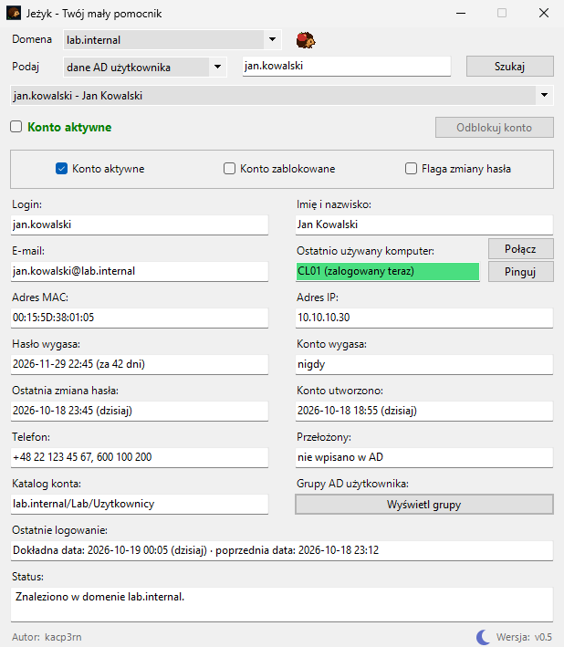
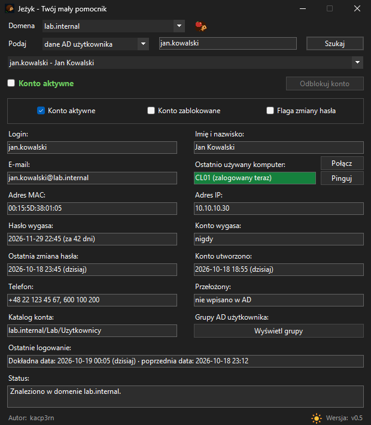
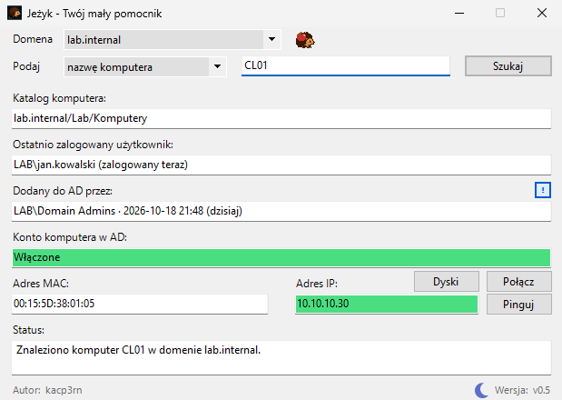
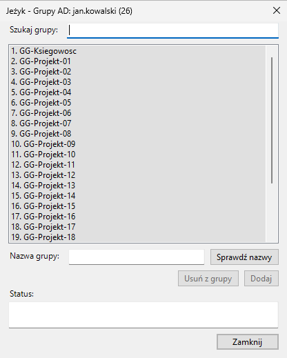

# 🦔 "Jeżyk" – Szybki weryfikator AD i SCCM

Okienkowe narzędzie dla helpdesku i administratorów Windows. Wpisujesz login, imię
i nazwisko, e-mail, numer telefonu albo nazwę komputera i w jednym oknie widzisz, czy
konto jest zablokowane, kiedy wygasa hasło, kiedy ktoś się ostatnio logował, z jakiego
komputera korzysta i czy maszyna w ogóle odpowiada. Bez przeklikiwania się przez konsolę
AD i konsolę SCCM, kolor werdyktu od razu mówi, czy wszystko jest w porządku.

 

## Co potrafi narzędzie?

- **Konto użytkownika** — werdykt (aktywne, zablokowane, wyłączone), daty hasła i konta,
  dokładna data ostatniego logowania zebrana ze wszystkich kontrolerów domeny, telefon,
  e-mail, przełożony i katalog w AD.
- **Wyszukiwanie** po loginie, imieniu i nazwisku (w dowolnej kolejności), adresie e-mail
  i numerze telefonu w dowolnym zapisie.
- **Ostatnio używany komputer** z inwentaryzacji SCCM (ze stanem sesji), adresem IP i MAC,
  sprawdzeniem, czy maszyna odpowiada, i zdalną konsolą jednym kliknięciem.
- **Komputer** — gdzie leży w AD, kto ostatnio z niego korzystał, kto dodał go do domeny,
  czy jego konto w domenie jest włączone, oraz szybkie otwarcie udziałów `C$` i `D$`.
- **Grupy AD** konta z wyszukiwarką, a w domenach, w których to włączono: dopisanie do
  grupy, usunięcie z niej i odblokowanie konta — zawsze po potwierdzeniu.
- **Jasny i ciemny motyw** oraz przycisk „!” przy każdym polu, opisujący aktualny błąd.

 

## W jaki sposób działa?

- **Windows PowerShell 5.1 i WinForms, bez instalacji.** Potrzebny jest tylko moduł
  `ActiveDirectory` z RSAT. SCCM czyta się przez CIM/WMI, a kilka funkcji systemu (ciemny
  pasek tytułu, systemowe okno poświadczeń, łączenie z udziałem) przez krótki blok C#.
- **Warstwy z twardymi granicami.** Logika (AD, SCCM, walidacja) nie ma ani linijki kodu
  okna, a widok nie wysyła ani jednego zapytania do sieci. Logika oddaje jeden kształt wyniku
  i nigdy nie rzuca wyjątkiem, więc okno zawsze ma co pokazać.
- **Okno nie zamarza.** Wolne rzeczy: dokładna data logowania, SCCM, ping, wyszukiwanie po
  numerze, łączenie z udziałem, wyszukiwanie grup biegną jako siedem niezależnych zadań
  w tle. Każde ma własny licznik pokoleń, więc spóźniona odpowiedź o poprzednie konto nie
  nadpisze bieżącego.
- **Mówi, dlaczego coś nie wyszło.** Przyczyna niepowodzenia trafia pod „!” przy polu. Jest
  rozpoznawana po kodzie błędu, a nie po treści komunikatu zależnej od języka systemu.
- **Sprawdzany automatycznie.** Zestaw weryfikacyjny (kilka tysięcy sprawdzeń, poza tym
  repozytorium) wykonuje logikę na atrapach AD i SCCM podstawionych na styku z systemem
  i pilnuje struktury kodu przez analizę AST.

## Założenia

1. **Nic nie instaluje i nic nie zmienia w systemie** — korzysta tylko z tego, co już jest
   na stacji.
2. **Nic nie zgaduje** — domeny, kontrolery i serwer SCCM pochodzą wyłącznie z konfiguracji;
   brak wpisu daje komunikat, a nie domysł.
3. **Do odczytu, z dwoma wyjątkami** — odblokowanie konta i zmiana członkostwa w grupach,
   każde z własną listą domen, potwierdzeniem i sprawdzeniem uprawnień w samej funkcji
   zapisu.
4. **Hasło do jednego uwierzytelnienia** — systemowe okno poświadczeń, `SecureString`,
   bufory zerowane po użyciu i żadnej drugiej próby tymi samymi danymi.

## Uruchomienie

1. Windows 10 lub 11, Windows PowerShell 5.1 i moduł `ActiveDirectory` (RSAT). SCCM jest
   opcjonalny, ale zalecany.
2. Domeny, kontrolery i serwer SCCM wpisz w bloku `$Script:Ustawienia`
   w `Jezyk-1-Srodowisko.ps1` (w repozytorium stoją atrapy: `jezyk.pl`, `zolw.pl`,
   `wydra.pl`).
3. Uruchom dwuklikiem `Launcher-Jezyk.cmd` (wymagane uprawnienia administratora).

## Autor

[kacp3rn](https://github.com/kacp3rn)

Wszelkie prawa zastrzeżone, szczegóły w pliku [LICENSE](LICENSE).

---

## Wyjaśnienia do kodu

Komentarze w kodzie odsyłają tutaj dopiskiem `(README: …)`. Tekst po dwukropku to początek
jednego z nagłówków poniżej, pisany bez polskich znaków, a `>` prowadzi o poziom niżej,
np. `Kod > Jezyk-4-Okno > Zadania w tle`.

### Konfiguracja

Wszystko, co się ustawia, stoi w bloku `$Script:Ustawienia` na początku
`Jezyk-1-Srodowisko.ps1`: lista domen, domeny z odblokowaniem i domeny z zarządzaniem
grupami (osobno, bo w AD to dwie niezależne delegacje), opcjonalna lista kontrolerów,
poddrzewo przeszukania po numerze (`SzukajOd`), serwer, kod lokacji i protokół SCCM, domeny
znane SCCM i ścieżka do konsoli zdalnej. Osobnego pliku konfiguracyjnego nie ma, a Jeżyk
niczego nie odczytuje sam ani z rejestru, ani od klienta SCCM.

#### Sprawdzenie przy starcie

`Confirm-JezykUstawienia` sprawdza konfigurację raz, po wczytaniu wszystkich części,
i pokazuje **wszystkie** zastrzeżenia naraz, zanim wstanie okno: kształt nazw domen,
obecność domen z zapisem na liście domen, przynależność serwera SCCM i kontrolerów do
skonfigurowanych domen, trzyznakowy kod lokacji, pełną ścieżkę do konsoli. Przynależność
hosta do domeny liczy się z **kropką przed sufiksem** (`dc1.jezyk.pl` należy do `jezyk.pl`,
`zlyjezyk.pl` — nie) i porównaniem `Ordinal`: porównanie według kultury pomija niektóre
znaki jako nieistotne, więc nazwa spreparowana z takim znakiem mogłaby przejść.

### Bezpieczeństwo

Jeżyk czyta AD **kontem operatora**, widać w nim dokładnie to, co i tak widać w konsoli.
Pisze dwiema drogami (odblokowanie i członkostwo w grupach), a obie mają tę samą obudowę:
własną listę domen, potwierdzenie przed zapisem, sprawdzenie uprawnienia także w samej
funkcji zapisu i zapis przez emulator PDC. Obiekt do zapisu wskazuje nazwa wyróżniająca
oddana przez katalog, nigdy tekst z pola. Dane wejściowe przechodzą przez białe listy,
a metaznaki LDAP są osłaniane. Odmowa logowania kontem z okna poświadczeń trafia do
`Status:` osobnym zdaniem, z domeną tego konta, bez wpisanego loginu, żeby nie wyglądała
na kłopot z odblokowywanym kontem.

### Odblokowanie konta

Przycisk „Odblokuj konto” istnieje tylko w domenach z listy `DomenyZOdblokowaniem`, gdzie
indziej nie ma go nawet wyszarzonego, bo tam nie zadziała nigdy. Potwierdzeniem jest
systemowe okno poświadczeń Windows, a hasło z niego idzie do **jednego** wywołania
`Unlock-ADAccount`: emulator PDC i stan konta z okna czyta się kontem operatora, więc złe
hasło nie zużywa kolejnych prób logowania. Odmowa uprawnień to zwykła odpowiedź AD, a nie
wyjątek; odmowa logowania wraca do okna poświadczeń z komunikatem Windows (złe hasło, konto
zablokowane, wyłączone), zamiast kończyć się ciszą.

### Co pokazuje okno?

#### Ostatnie logowanie — dlaczego dwie daty?

AD zapisuje logowanie w dwóch atrybutach: `lastLogonTimestamp` jest replikowany, ale
odświeżany tylko co 9–14 dni, a `lastLogon` jest dokładny, tyle że każdy kontroler zna
wyłącznie logowania, które sam obsłużył. Pole pokazuje więc najpierw datę przybliżoną,
a w tle zbiera `lastLogon` ze **wszystkich** kontrolerów poprzez moduł AD, tą samą drogą co
reszta programu. „Dokładna data” pojawia się tylko przy komplecie odpowiedzi. Bez kompletu
pole mówi „Najpóźniejsza znana”, `lastLogonTimestamp` służy za podłogę, a przebieg kontroler
po kontrolerze trafia pod „!”.

#### Wyszukiwanie po numerze telefonu

Numery bywają zapisane w AD w dowolnej postaci (`+48123456789`, `123 456 789`…), a
`telephoneNumber` i `mobile` nie są indeksowane, więc kontroler przegląda konto po koncie.
Dlatego numer idzie osobnym zadaniem w tle, z `-ResultPageSize` równym limitowi trafień
(pracę kontrolera kończy rozmiar strony, a nie licznik wyników) i opcjonalnym zawężeniem
`SzukajOd`. Trafienia doklejają się na koniec listy, bez ruszania zaznaczenia. Gdy po nazwie
nic się nie znalazło, a zadanie numeru ruszyło, `Status:` mówi, że szukanie trwa. Samo
„nie znaleziono” byłoby wtedy nieprawdą; każda odpowiedź (trafienia, brak, zbyt wiele,
przerwane) zastępuje tę notkę.

##### Rdzeń numeru i jego świadoma cena

Porównujemy **rdzeń**: ostatnie dziewięć cyfr, czyli numer abonencki bez kodu kraju. Dzięki
temu `123456789` trafia w zapisane `+48 123 456 789` i odwrotnie. Świadoma cena: dłuższy
numer kończący się tymi samymi cyframi też przejdzie. Kosztem fałszywego trafienia jest
jeden dodatkowy wiersz na liście, a kosztem przeoczonego jest całe nieudane wyszukiwanie.

#### Ostatnio używany komputer

AD nie wie, gdzie ktoś się logował — `lastLogon` mówi kiedy, nigdy gdzie. Źródłem jest
inwentaryzacja SCCM, więc pole nazywa się „ostatnio **używany**”, a w nawiasie pokazuje stan
sesji („zalogowany teraz”) albo samą datę: `LastActiveTime` to aktywność klienta SCCM, a nie
logowanie, więc godzina sugerowałaby dokładność, której nie ma. Główne zapytanie stoi na
`SELECT *`, ponieważ jedna kolumna nieznana danej wersji SCCM wywróciłaby całe szukanie.
Adres IP daje sonda ICMP, a MAC dobiera się do tego adresu z kart zapisanych w inwentaryzacji,
dokładnie albo po podsieci.

##### Pytamy o to samo, co pokazuje konsola

Kolejność źródeł zaczyna się od tego, co operator widzi w węźle **Devices** konsoli
ConfigMgr: `SMS_CombinedDeviceResources` (`CurrentLogonUser`, `LastLogonUser`,
`PrimaryUser`), potem rekord odkrycia (`SMS_R_System.LastLogonUserName`), na końcu
inwentaryzacja sprzętu. Zapytanie WQL tylko przesiewa, a o tym, czy to ten login, rozstrzyga
dokładne porównanie w kodzie. Przy kilku maszynach wygrywa ta, przy której ktoś siedzi teraz.

##### Dwa stosy WMI, nie jeden

Po **odmowie dostępu** z `Get-CimInstance` (stos MI) to samo zapytanie idzie jeszcze raz
przez `Get-WmiObject` (klasyczny COM/DCOM, jak konsola ConfigMgr). Autoryzacja jest w obu
inna, więc jeden potrafi przejść tam, gdzie drugi się odbija. Każdy inny błąd powtórzyłby się
identycznie, więc druga próba pada tylko po odmowie. Który stos oddał wynik, widać pod „!”.

##### `-SkipTestConnection` jest warunkiem działania (nie oszczędnością)

`New-CimSession` domyślnie sprawdza połączenie w `root\cimv2`, a nie w `root\sms`. Prawa
do SCCM nadaje się zwykle właśnie na `root\sms`. Test odbijał się więc od bramki, której
prawdziwe zapytanie nigdy nie dotyka. Konsola ConfigMgr takiego testu nie robi i Jeżyk też
nie; zabezpieczeniem zostaje sonda portu przed sesją i limit czasu na każde zapytanie.

##### Data przychodzi w UTC

SCCM trzyma znaczniki czasu w UTC, a pole pokazuje czas lokalny. Przelicza je jedna funkcja
(`ConvertTo-JezykCzasLokalny`), bo ta sama data przychodzi w różnych kształtach:
`Get-CimInstance` oddaje ją już przeliczoną (`Kind = Local`), a `Get-WmiObject` jako łańcuch
DMTF, także z zapisem `+***` oznaczającym czas bez strefy. Wartość, której nie da się
odczytać, to `$null`, a nie wyjątek.

#### Przycisk „Dyski” — udziały administracyjne maszyny

„Dyski” otwiera w Eksploratorze `\\NAZWA\C$` albo `D$`. Najpierw jednak zestawia sesję
z udziałem: cicha próba (`WNetAddConnection3`) idzie w tle, a jeśli potrzebne są
poświadczenia, systemowe okno o nie pada na **wątku interfejsu**, z oknem Jeżyka jako
rodzicem. Przestrzeń w tle nie ma ani rodzica, ani pętli komunikatów. Dopiero przy gotowej
sesji ścieżka idzie do powłoki i wraca od razu, bo nie ma już z kim rozmawiać.

#### Grupy o tej samej nazwie

Nazwa grupy (CN) jest unikalna tylko w swoim kontenerze, więc konto może należeć do dwóch
grup (np. `GG_Kadry` z dwóch jednostek). Tożsamością grupy jest więc nazwa wyróżniająca:
powtórzenia odsiewa się po DN, powtórzona nazwa dostaje w nawiasie folder AD, a pytanie
przed zapisem pokazuje folder zawsze. Kolejność listy ustala jedna funkcja, a wołający owija
jej wynik w `@()`.

#### Usunięcie bierze grupę z zaznaczenia, nie z pola

„Usuń z grupy” działa na zaznaczonym wierszu, a wiersze listy to tylko napisy. Lista jedzie
więc przez okno jako **pary** „nazwa + nazwa wyróżniająca”, filtr oddaje pary, a numeruje je
jedna funkcja (`Get-JezykWierszeGrup`) z tej samej tablicy, z której bierze się zaznaczenie.
Inaczej po zawężeniu filtra konto zostałoby usunięte z innej grupy niż zaznaczona (bez
żadnego komunikatu).

#### Przycisk „!”

„!” stoi przy polu wtedy i tylko wtedy, gdy dane wyszukanie ma coś do zgłoszenia. Czerwony:
funkcja naprawdę zawiodła, niebieski: wynik jest niejednoznaczny. Treść ustawia się
wyłącznie na ścieżce błędu, a ścieżka sukcesu jawnie ją gasi. Stały, zawsze widoczny „!”
przestałby cokolwiek sygnalizować.

#### Praca w tle

Siedem zadań: logowanie, dwa zadania SCCM, ping, numer telefonu, łączenie z udziałem i
wyszukiwanie grup. Przebiegają w osobnych przestrzeniach uruchomieniowych, każde z własnym
licznikiem pokoleń, więc pole wypełnia się, gdy dojdzie **jego** wynik. Odpowiedzi odbiera
zegar WinForms na wątku okna. Przestrzeń wolno zwolnić dopiero po zakończeniu: `Dispose` na
biegnącej przechodzi w zatrzymanie synchroniczne i zamraża okno. Animowany jeż rusza się
tylko wtedy, gdy wątek okna pompuje komunikaty, przy szybkim zapytaniu synchronicznym stoi.

#### Ciemny motyw

Przycisk z księżycem przełącza okno na tło, które Windows 11 daje oknom w ciemnym motywie;
w ciemnym oknie ikonka staje się słońcem. Kolory idą przez role kontrolek, a kolor niosący
**znaczenie** (np. czerwień werdyktu) nakłada się po kolorach ról. Odwrotna kolejność
zdjęłaby czerwień i okno przez chwilę mówiłoby, że z kontem wszystko w porządku. Tła pól
z kolorem mają kontrast napisu co najmniej 4,5:1, a elementy, których WinForms nie daje
przemalować (ramka `GroupBox`, przycisk listy rozwijanej), są rysowane od nowa.

### Pułapki, które psuły ten kod

Każda z nich raz wystąpiła i żadna nie dała komunikatu:

- **Kod wczytany z udziału pytał o swój plik długo po starcie.** Windows PowerShell 5.1
  kompiluje funkcję przy pierwszym wykonaniu i sprawdza przy tym plik źródłowy po pełnej
  ścieżce. Przy wyłączonym komputerze z udziałem każda pierwsza czynność czekała do limitu
  czasu sieci. Części wczytuje się więc z pamięci, z samą nazwą pliku.
- **Po zwolnieniu konsoli strumień błędów nadal trafiał do hosta.** Zapis rzucał
  wyjątkiem i urywał procedurę zdarzenia w połowie. Wszystkie strumienie okna trafiają dziś do
  `Add-JezykBladOkna` i pod „!”.
- **Obsługa błędu nie może rzucić wyjątkiem.** Wyjątek wychodzi z `ShowDialog` i zamyka
  program, dlatego zapisuje najpierw treść, najprostszym wyrażeniem.
- **Zablokowany port trzyma połączenie ok. 21 s.** Zanim pójdzie odczyt AD albo sesja WMI,
  idzie sonda portu z krótkim terminem dla wszystkich kontrolerów naraz, a nie po kolei.
- **Niepełna lista funkcji wstrzykiwanych do zadania w tle.** Przestrzeń startuje pusta, więc
  pominięta funkcja to wyjątek wewnątrz zadania, a w oknie tylko brak wyniku.
- **`@($null)` ma jeden element, a `return ,$x` i `@()` się wykluczają,** „nic” przechodziło
  przez warunki jak „jedno”, a lista docierała jako jeden obiekt.
- **`'{0} {1}' -f $a, $b` w argumencie metody .NET dostaje tylko `$a`,** przecinki należą
  do listy argumentów metody.
- **Porażka, która wygląda jak wynik, jest gorsza od komunikatu o błędzie,** dlatego stan
  wyniku mówi o sobie w polu, które operator czyta.

### Kod plik po pliku

Pięć plików `.ps1` dołączanych kropką do jednego zakresu (nie są to osobne moduły),
a kolejność wynika z zależności: `Kod-Jezyk.ps1` → `Jezyk-1-Srodowisko.ps1` →
`Jezyk-2-Logika.ps1` → `Jezyk-3-Widok.ps1` → `Jezyk-4-Okno.ps1`. Każda część ma własny
`trap` i kończy się funkcją kontrolną, po której plik wejściowy poznaje, że wczytała się
w całości.

#### Kod-Jezyk.ps1

Plik wejściowy: wycisza preferencje, które po zwolnieniu konsoli pisałyby do hosta, wczytuje
cztery części **z pamięci** (bajty bez znacznika BOM, parser z samą nazwą pliku bez
powiązania z katalogiem wdrożenia), sprawdza ich kompletność i uruchamia okno w bloku, który
zbiera wszystkie strumienie do obsługi błędów okna.

#### Launcher-Jezyk.cmd

WinForms wymaga trybu STA, którego nie da się włączyć z wnętrza działającego skryptu, więc
program startuje przez launcher. Ten sprawdza komplet plików (i pokazuje **całą** listę
braków), woła `powershell.exe` pełną ścieżką i przed startem przechodzi do `%SystemRoot%`,
żeby uruchomiony proces nie dziedziczył uchwytu katalogu wdrożenia, inaczej folderu nie
dałoby się usunąć ani przemianować, dopóki okno jest otwarte.

#### Jezyk-1-Srodowisko.ps1

Konsola, biblioteki interfejsu, konfiguracja, paleta motywu i rejestry. Konsola znika
w dwóch fazach: ukrycie okna od razu, zwolnienie po załadowaniu modułu AD. Obie tylko
wtedy, gdy Jeżyk jest na niej jedynym procesem, żeby nie zabrać okna terminala, z którego
ktoś go uruchomił. Blok C# rejestruje też zapis wyjątku, którego nikt nie złapał, do pliku
awarii w `%TEMP%`.

#### Jezyk-2-Logika.ps1

AD, SCCM, walidacja i odblokowanie, bez ani jednej linijki kodu okna. Kształt ścieżki do
programu sprawdza własny wzorzec, a nie `IsPathRooted`, bo ta metoda odpowiada na inne
pytanie: o reguły bieżącej platformy, a nie o pełną ścieżkę windowsową. Funkcje oddające
listy oddają je bez przecinka przy `return`, a wołający owija wynik w `@()`.

#### Jezyk-3-Widok.ps1

Przełożenie wyniku na kontrolki i obsługa zdarzeń, bez zapytań do sieci. Kilka zachowań jest
celowych: przy podwójnym kliknięciu natywne zaznaczenie Windows jest tylko kotwicą,
a zaznaczenia przeciągniętego przez kilka słów nie ruszamy. Przyciski „Połącz” i „Dyski”
znikają przy stanie przejściowym, bo drogą powrotu jest „Pinguj”. Wybór grupy zapamiętuje się
dopiero **po** przepisaniu pola nazwą z AD, bo `TextChanged` zeruje go przy każdej zmianie tekstu.

#### Jezyk-4-Okno.ps1

Stałe siatki, rysunek i ruch jeża, budowa okna i zadania w tle.

##### Zadania w tle — mechanika

Przestrzeń uruchomieniowa startuje pusta, więc `New-JezykSkryptTla` wstrzykuje tekst funkcji,
całe domknięcie zależności, nie tylko pierwszy poziom. Wynik odbiera zegar
`$Script:ZegarTla` na wątku okna. Odbiór zdejmuje zadanie z rejestru **zanim** cokolwiek
narysuje: okna modalne (wybór grupy, poświadczenia) pompują takty zegara, więc drugi takt
wszedłby w ten sam odbiór jeszcze raz. Porzucone zadania przechodzą przez sprzątanie
dwuetapowe i są zwalniane dopiero po faktycznym zakończeniu.

### Budowa i rozbudowa

Kształt wyniku definiuje jedno miejsce: `New-JezykResult` w `Jezyk-2-Logika.ps1`, więc nowe
pole to cztery kroki: kontrolka w `New-JezykForm`, odczyt w widoku przez `$Script:Kontrolki`,
czyszczenie w `Clear-JezykKonto` albo `Clear-JezykKomputer` i, przy polu kolorowanym,
zerowanie koloru. Nowe zadanie w tle trzeba dopisać do listy funkcji wstrzykiwanych
w `New-JezykSkryptTla` i do jej `[ValidateSet]`.

#### Siatka okna liczy się sama

Żadna współrzędna nie jest wpisana ręcznie: wszystko wychodzi z kilku nazwanych stałych
i z **pomiaru** kontrolek, bo ich wysokość rośnie z czcionką i DPI systemu. Skok wiersza to
zmierzone pole plus jedna przerwa, a przycisk ma wysokość pola, jego napis rysuje się
samodzielnie z `Tag` w całym prostokącie, więc nie ma się gdzie uciąć. Zmienne nazywa się
pełnymi słowami: dla PowerShella `$R` i `$r` to ta sama zmienna.
